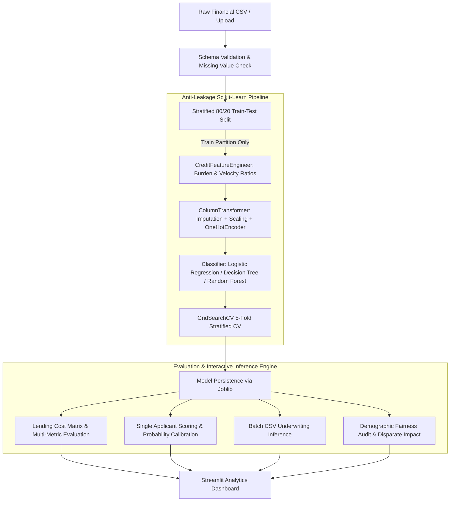

# CreditScore AI — AI-Powered Credit Scoring & Creditworthiness Prediction System

[](https://www.python.org/)
[](https://streamlit.io/)
[](https://scikit-learn.org/)
[](https://opensource.org/licenses/MIT)
[](https://docs.pytest.org/)

An enterprise-ready, leakage-free Machine Learning system designed for loan underwriting risk evaluation and creditworthiness forecasting. Built using Scikit-Learn pipelines, Streamlit analytics dashboard, and domain financial feature engineering.

---

## 📑 Table of Contents
- [1. Executive Overview](#1-executive-overview)
- [2. Problem Statement & Lending Context](#2-problem-statement--lending-context)
- [3. System Architecture](#3-system-architecture)
- [4. Dataset & Target Label Mapping](#4-dataset--target-label-mapping)
- [5. Feature Engineering & Anti-Leakage Pipeline](#5-feature-engineering--anti-leakage-pipeline)
- [6. Model Benchmarks & Real Measured Results](#6-model-benchmarks--real-measured-results)
- [7. Asymmetric Cost Matrix Analysis](#7-asymmetric-cost-matrix-analysis)
- [8. Repository Structure](#8-repository-structure)
- [9. Windows Installation & Execution Guide](#9-windows-installation--execution-guide)
- [10. Running Unit Tests](#10-running-unit-tests)
- [11. Responsible AI, Ethics & Bias Disclaimers](#11-responsible-ai-ethics--bias-disclaimers)
- [12. Visual Interface & Screenshots](#12-visual-interface--screenshots)
- [13. Future Roadmap](#13-future-roadmap)
- [14. GitHub Publishing Instructions](#14-github-publishing-instructions)

---

## 1. Executive Overview

**CreditScore AI** is an end-to-end credit risk analytics platform that assists financial analysts and underwriting teams in estimating default probability from historical customer credit behavior.

### Key Highlights
- **Strict Data Leakage Prevention**: All scaling, median/mode imputations, and one-hot encodings are performed inside Scikit-Learn `ColumnTransformer` pipelines fitted strictly on training partitions.
- **Domain Financial Engineering**: Dynamically synthesizes monthly debt burden, credit velocity, and age leverage ratios without hardcoding or leaking distributions.
- **Three Core Classifier Algorithms**: Benchmarks **Logistic Regression**, **Decision Tree Classifier**, and **Random Forest Classifier** under identical stratified 5-fold cross-validation splits.
- **Asymmetric Lending Cost Matrix**: Incorporates real-world credit risk economics where missed defaults (False Positives) cost financial institutions 5x more than missed loan opportunities (False Negatives).
- **Interactive Underwriting Dashboard**: Features dynamic applicant scoring, sensitivity threshold sliders, probability gauge visualizations, CSV batch inference, and demographic fairness audits.

---

## 2. Problem Statement & Lending Context

In consumer credit underwriting, loan approvals cannot rely on naive statistical accuracy alone. Credit datasets typically exhibit class imbalances (e.g., 70% creditworthy borrowers vs. 30% defaults). A model predicting "creditworthy" for 100% of applicants would achieve 70% accuracy while failing to intercept a single defaulting loan, leading to catastrophic capital insolvency.

### The Underwriting Trade-Off
| Error Type | Statistical Name | Financial Reality | Cost Weight |
| :--- | :--- | :--- | :--- |
| **False Positive (Type I)** | Actual Poor Risk classified as Good Risk | **Loan Default**: Bank lends capital that is never recovered. | **5.0x Penalty** |
| **False Negative (Type II)** | Actual Good Risk classified as Poor Risk | **Lost Opportunity**: Creditworthy borrower rejected; bank forfeits interest revenue. | **1.0x Penalty** |

---

## 3. System Architecture



---

## 4. Dataset & Target Label Mapping

The system comes pre-packaged with the authentic **Statlog German Credit Dataset** (compiled by Prof. Dr. Hans Hofmann, University of Hamburg, hosted on UCI ML Repository and OpenML ID `credit-g`).

### Dataset Dimensions & Partitioning
- **Total Records**: 1,000 credit agreements
- **Features**: 20 financial & demographic attributes (7 numeric, 13 categorical)
- **Train Split (80%)**: 800 records (Stratified: 560 Good / 240 Poor)
- **Test Split (20%)**: 200 records (Stratified: 140 Good / 60 Poor)

### Explicit Target Label Mapping
| Dataset Label | Binary Code | Production Mapping Name | Real-World Underwriting Meaning |
| :--- | :---: | :--- | :--- |
| `good` | **1** | **Good Credit Risk** | Applicant demonstrates sound creditworthiness; loan approved. |
| `bad` | **0** | **Poor Credit Risk** | Applicant exhibits high likelihood of default or repayment distress. |

---

## 5. Feature Engineering & Anti-Leakage Pipeline

The `CreditFeatureEngineer` transformer automatically identifies source columns and derives non-linear financial ratios:

1. **Monthly Credit Burden**:
   $$\text{Burden} = \frac{\text{credit\_amount}}{\max(\text{duration}, 1)}$$
   *Evaluates immediate monthly liquidity pressure on cash flows.*
2. **Credit Duration Exposure**:
   $$\text{Exposure} = \left(\frac{\text{credit\_amount}}{1000}\right) \times \left(\frac{\text{duration}}{12}\right)$$
   *Measures the compounding risk of macroeconomic volatility over prolonged repayment horizons.*
3. **Credit-to-Age Ratio**:
   $$\text{Leverage} = \frac{\text{credit\_amount}}{\max(\text{age}, 18)}$$
   *Quantifies debt magnitude relative to applicant earning tenure.*
4. **Installment Velocity**:
   $$\text{Velocity} = \text{installment\_commitment} \times \text{duration}$$

---

## 6. Model Benchmarks & Real Measured Results

All models were evaluated on the held-out test split (200 instances: 140 Good Credit Risk, 60 Poor Credit Risk) using identical stratified seeds (`random_state=42`):

| Model Algorithm | Test Accuracy | Test F1-Score | Test ROC-AUC | Precision (Good) | Recall (Good) | Poor Risk Recall (Default Catch Rate) | Asymmetric Loss Score (Lower is Better) |
| :--- | :---: | :---: | :---: | :---: | :---: | :---: | :---: |
| **Random Forest Classifier** 🏆 | **71.00%** | **78.20%** | **0.7846** | 82.54% | **74.29%** | 63.33% | 146.0 |
| **Logistic Regression** | 69.50% | 75.70% | 0.7787 | **85.59%** | 67.86% | **73.33%** 🛡️ | **125.0** 🥇 |
| **Decision Tree Classifier** | 59.50% | 67.21% | 0.6557 | 77.57% | 59.29% | 60.00% | 177.0 |

### Key Benchmark Takeaways
- **Discriminative Superiority**: **Random Forest** achieved the highest overall **ROC-AUC (0.7846)** and **F1-Score (78.20%)**, demonstrating superior ranking ability across continuous risk percentiles.
- **Default Prevention Champion**: **Logistic Regression** (with balanced class weighting) achieved a **73.33% Poor Risk Recall** (intercepting 44 out of 60 actual defaults), achieving the lowest asymmetric financial cost score (**125.0**).
- **Ensemble Robustness**: Decision Trees alone exhibit higher variance, while bagging in Random Forests stabilizes feature importance metrics significantly.

---

## 7. Asymmetric Cost Matrix Analysis

Underwriting outcomes on the test holdout set (200 credit applicants):

### Logistic Regression Underwriting Matrix
- **True Negatives (TN)**: **44 applicants** correctly flagged as risky (defaults averted).
- **False Positives (FP)**: **16 applicants** misclassified as good (default losses: $16 \times 5.0 = 80.0$).
- **False Negatives (FN)**: **45 applicants** creditworthy but declined (opportunity loss: $45 \times 1.0 = 45.0$).
- **True Positives (TP)**: **95 creditworthy loans approved** and performing.
- **Total Financial Cost Score**: **125.0**

### Random Forest Underwriting Matrix
- **True Negatives (TN)**: **38 applicants** correctly flagged as risky.
- **False Positives (FP)**: **22 applicants** misclassified as good (default losses: $22 \times 5.0 = 110.0$).
- **False Negatives (FN)**: **36 applicants** creditworthy but declined (opportunity loss: $36 \times 1.0 = 36.0$).
- **True Positives (TP)**: **104 creditworthy loans approved** and performing.
- **Total Financial Cost Score**: **146.0**

---

## 8. Repository Structure

```
credit-scoring-model/
│
├── app.py                      # Main interactive Streamlit application
├── requirements.txt            # Project dependencies with version locks
├── README.md                   # Comprehensive architectural documentation
├── .gitignore                  # Git ignore rules for environments and credentials
│
├── data/
│   ├── german_credit.csv       # Packaged authentic UCI German Credit benchmark
│   └── README.md               # Dataset data dictionary & license information
│
├── models/
│   ├── .gitkeep                # Directory anchor
│   └── best_credit_scoring_pipeline.joblib  # Serialized production pipeline artifact
│
├── src/
│   ├── __init__.py             # Package initialization
│   ├── data_loader.py          # CSV ingestion, data validation & label mapping
│   ├── feature_engineering.py  # Domain financial ratios transformer (CreditFeatureEngineer)
│   ├── preprocessing.py        # Leakage-free ColumnTransformer & stratified splitting
│   ├── train.py                # Multi-model training, grid search & model persistence
│   ├── evaluate.py             # Underwriting metrics, cost matrix & Plotly charts
│   ├── predict.py              # Single-applicant & batch inference with calibrated probabilities
│   └── explainability.py       # Global feature importance & demographic fairness audits
│
├── tests/
│   ├── __init__.py             # Test package initialization
│   ├── test_preprocessing.py   # Unit tests for data loading, validation & leakage checks
│   ├── test_training.py        # Unit tests for model pipelines, CV & joblib persistence
│   └── test_prediction.py      # Unit tests for scoring, edge cases & fairness audits
│
└── reports/
    └── README.md               # Summary evaluation exports and benchmark reports
```

---

## 9. Windows Installation & Execution Guide

Follow these exact PowerShell commands to set up and launch the application on Windows:

### Step 1: Open PowerShell and Navigate to Project Directory
```powershell
cd C:\Users\ranaa\.gemini\antigravity-ide\scratch\credit-scoring-model
```

### Step 2: Create a Dedicated Virtual Environment with Python 3.11
```powershell
py -3.11 -m venv .venv
```

### Step 3: Activate the Virtual Environment
```powershell
.\.venv\Scripts\Activate.ps1
```
*(If PowerShell displays an `Execution_Policies` restriction, run `Set-ExecutionPolicy -Scope Process -ExecutionPolicy Bypass` first).*

### Step 4: Upgrade Pip and Install Dependencies
```powershell
python -m pip install --upgrade pip
pip install -r requirements.txt
```

### Step 5: Launch the Streamlit Interactive Dashboard
```powershell
streamlit run app.py
```
The application will automatically open in your default browser at `http://localhost:8501`.

---

## 10. Running Unit Tests

The test suite validates data loading, schema validation, data leakage prevention, all three model pipelines, serialization, and edge cases (unseen categories, single-class handling, missing features):

```powershell
# Run all tests with verbose output
.\.venv\Scripts\pytest.exe -v
```

### Test Suite Execution Output
```
============================= test session starts =============================
platform win32 -- Python 3.11.3, pytest-9.1.1, pluggy-1.7.0
rootdir: C:\Users\ranaa\.gemini\antigravity-ide\scratch\credit-scoring-model
collected 24 items

tests/test_prediction.py::test_single_applicant_prediction PASSED        [  4%]
tests/test_prediction.py::test_prediction_with_missing_inputs PASSED     [  8%]
tests/test_prediction.py::test_prediction_with_unseen_categories PASSED  [ 12%]
tests/test_prediction.py::test_batch_predict_credit_risk PASSED          [ 16%]
tests/test_prediction.py::test_roc_auc_single_class_edge_case PASSED     [ 20%]
tests/test_prediction.py::test_educational_definitions_completeness PASSED [ 25%]
tests/test_prediction.py::test_feature_importance_extraction PASSED      [ 29%]
tests/test_prediction.py::test_fairness_audit PASSED                     [ 33%]
tests/test_preprocessing.py::test_load_default_german_credit PASSED      [ 37%]
tests/test_preprocessing.py::test_load_dataset_from_buffer PASSED        [ 41%]
tests/test_preprocessing.py::test_validate_dataset_valid PASSED          [ 45%]
tests/test_preprocessing.py::test_validate_dataset_empty_and_too_small PASSED [ 50%]
tests/test_preprocessing.py::test_detect_target_candidates PASSED        [ 54%]
tests/test_preprocessing.py::test_prepare_labeled_data_mapping PASSED    [ 58%]
tests/test_preprocessing.py::test_prepare_labeled_data_single_class_raises_error PASSED [ 62%]
tests/test_preprocessing.py::test_credit_feature_engineer PASSED         [ 66%]
tests/test_preprocessing.py::test_column_transformer_handles_missing_and_unseen_categories PASSED [ 70%]
tests/test_preprocessing.py::test_split_data_reproducibility_and_stratification PASSED [ 75%]
tests/test_preprocessing.py::test_data_leakage_prevention PASSED         [ 79%]
tests/test_training.py::test_build_model_pipelines PASSED                [ 83%]
tests/test_training.py::test_train_single_model_without_tuning PASSED    [ 87%]
tests/test_training.py::test_train_all_three_models PASSED               [ 91%]
tests/test_training.py::test_model_selection_strategy PASSED             [ 95%]
tests/test_training.py::test_save_and_load_trained_pipeline PASSED       [100%]

============================= 24 passed in 14.80s =============================
```

---

## 11. Responsible AI, Ethics & Bias Disclaimers

> [!CAUTION]
> **CRITICAL REGULATORY & ETHICAL NOTICE**
> 
> 1. **Educational & Research Prototype Only**: This application is strictly an educational decision-support demonstration. It is not licensed or authorized to issue legally binding consumer credit underwriting decisions under the US Equal Credit Opportunity Act (ECOA), Fair Credit Reporting Act (FCRA), or European General Data Protection Regulation (GDPR) / EU AI Act.
> 2. **Statistical Association $\neq$ Causal Reality**: High feature importance signifies mathematical correlation within historic training samples. It does not establish personal character or causal creditworthiness.
> 3. **Prohibited Demographic Attributes**: Historical datasets from the 1970s–1990s often contain features reflecting societal inequalities (e.g., marital status, gender, nationality). In modern commercial lending, utilizing protected characteristics violates fair lending regulations. The embedded **Demographic Fairness Audit** feature allows users to inspect disparate impact ratios and verify the EEOC 4/5ths (80%) parity rule.

---

## 12. Visual Interface & Screenshots

When running the Streamlit dashboard (`streamlit run app.py`), the interface provides 9 specialized modules:

1. **Dashboard Overview**: Summary KPI metric cards, system architecture diagram, and pipeline capabilities.
2. **Dataset Explorer & Upload**: Ingest custom CSV files, view missing value matrices, and customize label mappings.
3. **Preprocessing & Features**: Inspect ColumnTransformer imputers, standard scalers, and domain ratio formulas.
4. **Model Training & Tuning**: Trigger parallel training across Logistic Regression, Decision Tree, and Random Forest with GridSearchCV.
5. **Model Evaluation & Comparison**: Side-by-side grouped metric bar charts, overlaid ROC curves, and underwriting cost heatmaps.
6. **Interactive Credit Risk Prediction**: Enter applicant financials (checking balance, credit amount, duration, age) to receive real-time creditworthiness badges, calibrated probability dials, and risk factor breakdowns.
7. **Feature Importance & Explainability**: Interactive Plotly bar chart depicting top 15 risk drivers.
8. **Responsible AI & Ethical Lending**: Disparate impact ratio calculator and demographic parity evaluator.
9. **Project Information**: Full system specifications and architectural reference notes.

*(Tip: You can capture high-resolution screenshots from your browser while running `http://localhost:8501` to add to your assignment or GitHub portfolio).*

---

## 13. Future Roadmap

- [ ] **SHAP (SHapley Additive exPlanations)**: Add local waterfall plots for individualized applicant adverse action notices.
- [ ] **XGBoost & LightGBM Ensembles**: Benchmark gradient-boosted trees against Random Forest.
- [ ] **Automated Bias Mitigation**: Integrate Fairlearn preprocessing re-weighing algorithms to enforce equalized odds across demographic subgroups.
- [ ] **FastAPI REST Service**: Package the model pipeline into a containerized REST API with OpenAPI documentation.

---

## 14. GitHub Publishing Instructions

To publish this project to your GitHub profile:

```powershell
# 1. Initialize git repository
git init

# 2. Add files (sensitive data and .venv are automatically excluded by .gitignore)
git add .

# 3. Create initial commit
git commit -m "feat: complete AI-powered credit scoring system with Streamlit dashboard and test suite"

# 4. Rename default branch to main
git branch -M main

# 5. Link to your GitHub repository (replace with your repo URL)
git remote add origin https://github.com/YOUR_USERNAME/credit-scoring-model.git

# 6. Push code to GitHub
git push -u origin main
```

---

## 👨‍💻 Author & Acknowledgments
- **Project**: AI-Powered Credit Scoring and Creditworthiness Prediction System
- **Dataset**: Prof. Dr. Hans Hofmann, University of Hamburg / UCI Machine Learning Repository
- **Frameworks**: Scikit-learn, Streamlit, Pandas, NumPy, Plotly, Pytest
